<div align="center">

# 🎬 FilmIQ

**AI due diligence for film acquisitions.**
Upload a script, press kit or bid memo. Get a sourced, 13–16 page acquisition report with a bid range, streamed live to your browser.


[Quick start](#-quick-start) · [How it works](#-how-it-works) · [Configuration](#configuration) · [API](#-api) · [Contributing](#-contributing)

</div>

---

## Why FilmIQ?

Film acquisition decisions are noisy and time-sensitive. Before making an offer, a buyer needs answers to questions like these:

- What is this film actually worth, given the rights that are still available?
- How do comparable titles and priced deals stack up?
- Is the director or cast worth a premium?
- Which figures are backed by evidence, and which are guesses?
- What are the rights, market and execution risks?

Normally an analyst spends days pulling this together. FilmIQ runs six AI research specialists in parallel over your documents and the web. It checks every figure for a source and puts the results into a consistent, auditable deal memo in about 5–8 minutes.

## ✨ What you get

| | |
|---|---|
| 💰 **Bid card** | Opening bid, fair value and walk-away price, based only on the rights a new buyer can still license |
| 📊 **Confidence badge** | Calculated by code from the number of priced comparable deals, not chosen by the model |
| 🔎 **Evidence sections** | Story & rights · director & cast · market comparables · comparable deals · reception · risk register |
| 🧾 **Provenance on every figure** | Each number carries `[PDF p.N]`, a named source link, or an explicit `[unverified]` tag |
| ⚖️ **Source conflicts** | Notes where your documents and web research disagree |
| 📚 **References** | A full list of every cited source |
| 📈 **Grounding metric** | Citation coverage before and after verification, so you can see how well-sourced the report is |
| 🖨️ **PDF export** | A print-ready light-theme version of the report |

## 🎞️ The interface

The interface is designed to look like pages of a deal memo.

- **Two themes:** *Screening* (default, a dimmed screening room) and *Draft* (a script page). Your choice is saved.
- **Bid scale:** the range runs from opening bid to walk-away, with fair value placed by amount and marked with a goldenrod highlighter.
- **Provenance in the type:** `[PDF p.N]` citations are set in Courier Prime, the screenplay typeface. `[unverified]` figures are set in red.
- **Live progress:** fog drifts behind the header while the analysts work. It clears when the report arrives, and then the bid scale draws in.
- **Built for long reads:** a contents sidebar appears on wide screens, and a compact bid bar stays pinned under the nav.
- **Accessible motion:** all animation turns off under `prefers-reduced-motion`.

## 🚀 Quick start

### Prerequisites

- Docker (or Python 3.11 + [uv](https://docs.astral.sh/uv/) and Node.js 22 for a local setup)
- An **OpenAI** API key and a **Qdrant** cluster (the [Qdrant Cloud](https://cloud.qdrant.io) free tier works)
- Recommended: a **Tavily** API key ([free tier](https://tavily.com)) for reliable web search with real URLs

### Option 1: Docker (recommended)

```bash
git clone https://github.com/sainruthik/FilmIQ && cd FilmIQ
cp backend/.env.example backend/.env   # then fill in your keys
docker compose up --build
```

Open **http://localhost:3000** and upload a PDF. The API runs on `http://localhost:8000`.

> A full run takes about **5–8 minutes** and typically costs **$0.20–$0.50** in API usage.

### Option 2: Run locally

```bash
# Backend
cd backend
uv sync
cp .env.example .env                   # fill in your keys
uv run uvicorn main:app --reload --port 8000

# Frontend (in a second terminal)
cd frontend
npm install
cp .env.local.example .env.local       # NEXT_PUBLIC_API_URL=http://localhost:8000
npm run dev
```

See [docs/CONTRIBUTING.md](docs/CONTRIBUTING.md) for the full developer setup.

## 🧠 How it works

FilmIQ is a **LangGraph** pipeline. Six specialist agents run in parallel, a verifier checks their output, and a strategist writes the final assessment.

```mermaid
flowchart LR
    PDF[/"📄 PDF upload"/] --> Ingest["Ingest<br/>Qdrant + BM25 hybrid index"]
    Ingest --> Fan{{"Fan-out ×6"}}

    subgraph Specialists["Specialists (run in parallel)"]
        direction TB
        S1[Document Analyst]
        S2[Talent Researcher]
        S3[Market Analyst]
        S4[Deals Researcher]
        S5[Buzz Analyst]
        S6[Risk Analyst]
    end

    Fan --> Specialists
    Specialists --> Verify{"Verify<br/>every figure sourced?"}
    Verify -- "flagged (retry once,<br/>offenders only)" --> Specialists
    Verify -- ok --> Strategist["Strategist<br/>thesis · bid scenarios · conflicts"]
    Strategist --> Assemble["Assemble report<br/>bid card · tables · references"]
    Assemble -- SSE --> Browser[/"🖥️ Browser"/]
```



### Pipeline stages

| Stage | What it does |
|---|---|
| **Ingest** | Splits PDFs into chunks and indexes them in Qdrant with hybrid BM25 + embedding retrieval |
| **Specialists ×6** | Research agents each cover one area: story, talent, market, deals, buzz and risk |
| **Verify** | Flags figures that lack a valid source and re-runs only the specialists that produced them |
| **Strategist** | Writes the executive summary, investment thesis, bid scenarios and source-conflict notes |
| **Assemble** | Merges findings, strategy, citations and references into the final report |

### The specialists

| Specialist | Focus | Tools |
|---|---|---|
| Document Analyst | Story, financials, rights, windows | Documents |
| Talent Researcher | Director filmography, cast value | Documents + web |
| Market Analyst | Genre performance, comparable titles | Web |
| Deals Researcher | Priced licensing deals | Web |
| Buzz Analyst | Scores, critic quotes, sentiment | Web |
| Risk Analyst | Rights, rating, catalogue, licensee risk | Documents + web |

## 🧭 Design principles

1. **The model supplies data and the code controls structure.** Specialists return typed findings. Code renders the headings and tables, so every report has the same layout.
2. **Confidence is calculated, not generated.** Only single-film deals priced between $2M and $300M count as comparables.
   **High** = 2+ comparables · **Medium** = 1 · **Low** = none.
3. **The bid follows the available rights.** The valuation prices only what a new platform can still license. Budget, box office and break-even are never treated as fair market value.
4. **Grounding is measured.** Each report records citation coverage before and after verification.
5. **Failures are visible.** If OpenAI errors, chat models fall back to Groq and embeddings fall back to local FastEmbed. A specialist that fails is marked *incomplete* in the report, not quietly written around.

## 🛠️ Tech stack

| Layer | Technology |
|---|---|
| Frontend | Next.js 15, React 19, Tailwind CSS, react-markdown |
| Motion | GSAP + ScrollTrigger, Lenis smooth scroll, Vanta.js fog (three.js, lazy-loaded) |
| Backend | FastAPI, Python 3.11, slowapi rate limiting |
| Orchestration | LangGraph 1.2, LangChain Deep Agents 0.7 |
| LLMs | OpenAI `gpt-4o-mini` (specialists) / `gpt-4o` (strategist), Groq `openai/gpt-oss-120b` fallback |
| Retrieval | Qdrant + BM25, OpenAI `text-embedding-3-small`, FastEmbed fallback |
| Web search | Tavily, DuckDuckGo fallback |
| Tooling | uv, Docker Compose, Render (API), Vercel (frontend) |

<a id="configuration"></a>
## ⚙️ Configuration

All backend settings are read from `backend/.env` (start from [`backend/.env.example`](backend/.env.example)).

| Variable | Required | Default | Purpose |
|---|:---:|---|---|
| `OPENAI_API_KEY` | ✅ | | LLMs and embeddings |
| `QDRANT_HOST` | ✅ | | Qdrant cluster URL |
| `QDRANT_API_KEY` | ✅ | | Qdrant auth |
| `TAVILY_API_KEY` | Recommended | | Web search with real URLs (otherwise uses DuckDuckGo, which is free but rate-limited) |
| `OPENAI_WORKER_MODEL` | | `gpt-4o-mini` | Model used by the specialists |
| `OPENAI_STRATEGIST_MODEL` | | `gpt-4o` | Model used by the strategist |
| `GROQ_API_KEY` / `GROQ_MODEL` | | `openai/gpt-oss-120b` | Chat fallback on any OpenAI error |
| `TOKEN_SECRET` | Production | random per process | Signs job access tokens. Set a stable value so tokens survive restarts |
| `CORS_ORIGINS` | | `http://localhost:3000,…` | Comma-separated list of allowed frontend origins |
| `CORS_ORIGIN_REGEX` | | Vercel preview pattern | Extra origin regex, used for preview deployments |
| `LANGSMITH_TRACING` / `LANGSMITH_API_KEY` | | `false` | Optional tracing |

The frontend needs only `NEXT_PUBLIC_API_URL`. Next.js reads it **at build time**, so rebuild after you change it.

Limits such as file size (50 MB), concurrent analyses (3) and result retention (24 h) are set in [`backend/config.py`](backend/config.py).

> 🔒 **Confidential scripts:** LangSmith traces include the text of uploaded documents. Leave tracing off for sensitive material.

## 🔌 API

| Endpoint | Method | Description |
|---|---|---|
| `/api/upload` | `POST` | Upload up to 10 PDFs (multipart). Returns a `job_id` and a signed `access_token`. Rate limit: 10/min |
| `/api/analyze/{job_id}?token=…` | `GET` | Server-Sent Events stream of pipeline progress. Rate limit: 5/min |
| `/health` | `GET` | Liveness check that returns `{"status": "ok"}` |

**SSE event types:** `crew_start` → `status` / `agent_done` → `strategist_start` → `complete` (or `error`) → `stream_end`.

The `complete` event includes the report markdown, the `bid_range` and the `citation_coverage` metric. Finished reports are kept for 24 hours, and reconnecting to the same job replays the stored report without re-running the pipeline.

## 🗂️ Project structure

```text
FilmIQ/
├── backend/
│   ├── main.py              # FastAPI app, CORS, rate limiting
│   ├── config.py            # Settings (env-driven)
│   ├── api/
│   │   ├── routes/          # /upload and /analyze (SSE)
│   │   ├── auth.py          # signed job access tokens
│   │   ├── jobs.py          # in-memory job registry and event streams
│   │   └── limiter.py       # proxy-aware rate limiting
│   ├── pipeline/
│   │   ├── graph.py         # LangGraph: fan-out, verifier retry, strategist
│   │   ├── agents.py        # specialist agents, tools, budgets, fallbacks
│   │   ├── findings.py      # typed schemas, table rendering, comparable counting
│   │   ├── tasks.py         # prompts and report schema
│   │   ├── verifier.py      # citation checks and coverage metric
│   │   ├── report.py        # report assembly, bid card, references
│   │   ├── ingest.py        # PDF parsing and chunking
│   │   ├── rag.py           # Qdrant + BM25 hybrid retrieval
│   │   └── llm.py           # model factory with Groq / FastEmbed fallback
│   ├── tests/               # pytest suite (no external API calls)
│   ├── pyproject.toml / uv.lock
│   └── Dockerfile
├── frontend/
│   ├── app/                 # upload page and /analyze/[jobId] report view
│   ├── components/          # BidScale, ReportDisplay, VerdictReveal, Haze, ...
│   ├── lib/                 # API client, SSE hook, report parsing, theme
│   └── Dockerfile
├── docs/
│   ├── CONTRIBUTING.md      # dev setup, commands, tests, conventions
│   └── RUNBOOK.md           # deploy, monitoring, troubleshooting
├── docker-compose.yml
└── render.yaml              # Render blueprint for the API
```

## 🧪 Testing

```bash
cd backend && uv run pytest         # backend suite; never calls OpenAI, Tavily or Qdrant
cd frontend && npm run build        # type-checks the frontend
cd frontend && npm run check        # report-parsing checks
```

## ☁️ Deployment

- **Backend → Render:** [`render.yaml`](render.yaml) defines a Docker web service on port 10000 with a `/health` check. Set the secrets in the Render dashboard.
- **Frontend → Vercel:** build from `frontend/` with `NEXT_PUBLIC_API_URL` set to the Render URL, then add the Vercel URL to `CORS_ORIGINS`.

[docs/RUNBOOK.md](docs/RUNBOOK.md) has step-by-step deploy, monitoring and troubleshooting instructions.

## ⚠️ Known limitations

- **Priced comparables are scarce.** Many reports end up at Medium or Low confidence, and they say so.
- **Bid ranges vary between runs.** Rights grounding and calculated confidence narrow the variance but don't remove it.
- **Job state is in memory.** A backend restart drops running jobs. Run a single worker.
- **AI research is probabilistic.** FilmIQ is built to show uncertainty, not hide it. Treat the report as a starting point for diligence, not a final valuation.

## 👤 Author

Built by **[Sainruthik S](https://github.com/sainruthik)**.
